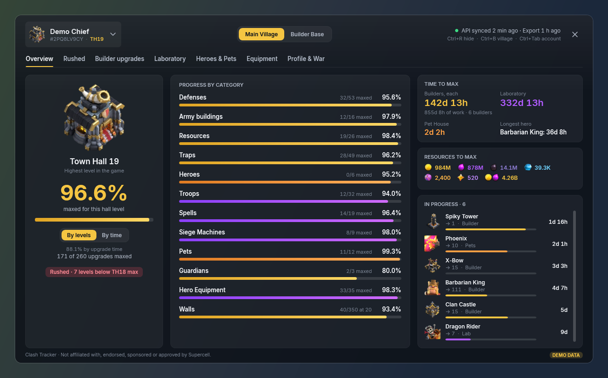

# Clash Tracker

A self-hosted Clash of Clans progress overlay for Windows. It waits in the system tray, notices
when Clash of Clans is running, and on **Ctrl+R** shows a large translucent dashboard over the
game. The dashboard covers:

* how close your village is to max for its Town Hall
* what is rushed, and by how much
* the longest builder and laboratory upgrades
* heroes, pets, equipment and ores
* your profile, clan, war and Clan War League

It does this for the Main Village and the Builder Base, for as many accounts as you like.



## How it works

* **It never touches the game.** No injection, no memory reading, no input automation, no packet
  capture. The app finds the game's window by its title and process name and draws its own window
  on top. It reads nothing else from the game.
* **It only listens for its own shortcuts.** So that Ctrl+R works while the game is in front,
  Clash Tracker watches the keyboard for its own shortcuts, and only while they are needed. Every
  other key goes straight to the game, and nothing you type is stored or sent anywhere.
* **Two sanctioned data sources:**
  * The official Clash of Clans API, with a key you make yourself. It gives heroes, troops,
    spells, pets, equipment, your profile, your clan and wars.
  * The village data export you copy from the game's settings. It gives buildings, traps, walls
    and running timers, which the API leaves out.
* **Game data from a maintained data set** ([ClashKing](https://github.com/ClashKingInc/ClashKingAssets)):
  upgrade costs, times, Town Hall caps and images. It is downloaded on first run and refreshed
  once a week, so nothing is typed into the code. Images are converted from WebP to PNG on your
  PC and kept in `%LOCALAPPDATA%\ClashOverlay\assets`.
* Between exports the overlay counts running timers down. You can mark an upgrade as done with
  **+1** on its row instead of exporting again.

## Install

1. Download `ClashOverlay-Setup-X.Y.Z.exe` from the
   [latest release](https://github.com/Gr1m0305/CoC-Progress-Overlay/releases/latest).
2. Run it. It installs for your Windows account only, into `%LOCALAPPDATA%\Programs\ClashOverlay`,
   without asking for administrator rights.
   * It adds a Start menu shortcut, and a desktop shortcut if you tick that box.
   * **Start Clash Tracker when I sign in to Windows** is ticked by default. It is the same switch
     as Settings → Data and updates, so changing either one changes both.
3. Leave **Launch Clash Tracker** ticked on the last page. The first time, Clash Tracker opens its
   setup, which has four steps:
   1. Make your API key (see [Getting an API key](#getting-an-api-key)).
   2. Paste the key.
   3. Add your player tags.
   4. Import your village.

### "Windows protected your PC"

Releases are only code-signed when a signing certificate is set up (see [Releasing](#releasing)).
For an unsigned release, Windows SmartScreen shows **Windows protected your PC** the first time you
run the setup:

1. Click **More info**.
2. Check that the app is `ClashOverlay-Setup-X.Y.Z.exe`.
3. Click **Run anyway**.

To check that the download is the published file, compare its hash with `SHA256SUMS.txt` from the
same release:

```powershell
Get-FileHash .\ClashOverlay-Setup-1.0.0.exe -Algorithm SHA256
```

### Updating

Clash Tracker checks GitHub for a new version each time it starts (when you sign in to Windows, if
it starts with Windows) and when you press **Check now** in Settings → Data and updates.

When there is one, it downloads the new setup, checks it against the release's SHA-256 checksums
and installs it quietly. Clash Tracker closes for a moment and starts again on the new version,
keeping your settings, key, accounts and data. If the overlay is open, it waits until you close it.
There are no pop-ups: the tray menu shows **Downloading…** or **Installing…** while it happens.

To decide yourself, turn off **Install updates automatically** in Settings → Data and updates. The
tray menu and that page then show **Install vX.Y.Z** when a new version is out.

You can also update by hand: download the new `ClashOverlay-Setup-X.Y.Z.exe` and run it. It closes
the running Clash Tracker and installs over the old version. Version 1.0.0 cannot update itself, so
install 1.1.0 this way.

### Uninstalling

In Windows, open **Settings** → **Apps**, find **Clash Tracker** and choose **Uninstall**.
Control Panel → Programs and Features works too. The uninstaller closes Clash Tracker and asks
whether to delete your data too. Then it removes the program, its shortcuts and the Start with
Windows entry. The answers to the data question:

* **No** (the default) keeps `%LOCALAPPDATA%\ClashOverlay`: your settings, the saved API key,
  your accounts, imported exports and the downloaded game data. If you install again later, Clash
  Tracker picks up where you left off.
* **Yes** deletes that folder as well.

A silent uninstall keeps the data unless you add `/DELETEDATA`:

```powershell
& "$env:LOCALAPPDATA\Programs\ClashOverlay\unins000.exe" /VERYSILENT /DELETEDATA
```

### Portable zip

`ClashOverlay-X.Y.Z-portable.zip` holds the same single `ClashOverlay.exe`, so it needs no
install:

* **To use it**, unzip it anywhere and run `ClashOverlay.exe`. It uses the same
  `%LOCALAPPDATA%\ClashOverlay` data folder as the installed copy. Only one copy runs at a time.
* **To start it with Windows**, turn on Settings → Data and updates → Start Clash Tracker when I
  sign in. Windows then starts the copy you ran.
* **To update it**, exit it from the tray and replace the exe. The portable copy does not update
  itself; when a new version is out, the tray menu shows **Download vX.Y.Z…**.
* **To remove it**, exit it from the tray and delete its folder. Delete
  `%LOCALAPPDATA%\ClashOverlay` too if you want your data gone.

## Using it

| Key | What it does |
| --- | --- |
| **Ctrl+R** | Show or hide the overlay (only while the game is the window in front) |
| **Ctrl+B** | Switch between Main Village and Builder Base |
| **Ctrl+Tab** | Next account |
| **Ctrl+1** … **Ctrl+9** | Jump to an account |
| **Esc** | Close the overlay |

All keys can be changed in Settings → Hotkeys. While the overlay is hidden, Clash Tracker
listens only for the toggle key, and only while the game is in front, so every other key goes to
the game as usual.

**To move the overlay**, hold the left mouse button anywhere on it and drag. **To resize it**,
drag one of its corners; it keeps its shape. Clash Tracker remembers where you left it. Settings →
Overlay → **Reset position and size** puts it back.

Main Village tabs:

* Overview
* Rushed
* To max
* Builder upgrades
* Laboratory
* Heroes & Pets
* Equipment
* Profile & War

Builder Base tabs:

* Overview
* To max
* Builder upgrades
* Star Laboratory
* Profile

What the tabs let you do:

* **To max** lists everything that can still be upgraded at your Town Hall level, in one place:
  buildings, traps, walls, heroes, troops, spells, siege machines, pets and equipment, grouped by
  type, with the time and cost left for each. The chips at the top show one type at a time.
* **Rushed** has a chip for each type with something rushed (Defenses, Traps, Heroes, Hero
  Equipment and so on), so you can look at one type at a time.
* **Builder upgrades** and **Laboratory** sort by longest or shortest time, or cheapest or priciest
  cost. When the upgrades use more than one resource, the chips on the right show only gold, only
  elixir, only dark elixir and so on.
* **Equipment** shows the pieces by hero, or as one list sorted by the ore for the next level,
  cheapest or priciest first, optionally for one ore only.

The overlay remembers the sort and filter you picked on each tab until it closes.

Settings → Overlay switches progress between **levels** (each level counts the same) and
**time** (weighted by upgrade time).

**Gold Pass boosts.** The game does not include builder and research boosts in the export or the
API, so set them per account in Settings → Accounts (none, 10%, 15% or 20%). Main Village builder
times (buildings, traps, walls and heroes) and laboratory times then use them. Pets, equipment and
the Builder Base are not affected, and upgrades already running keep their real timers.

## Getting an API key

Clash Tracker reads your profile from the official API with a key that only you hold. It is free.

1. Open <https://developer.clashofclans.com> and sign in, or create an account. A developer account
   is separate from your Supercell ID.
2. Go to **My Account** → **Create New Key**. Any name and description will do.
3. Under **Allowed IP addresses**, enter your PC's public IP address. The setup window shows it,
   with a Copy button.
4. Create the key, open it, and copy the long token shown under **Key**.
5. Paste it into Clash Tracker. Setup does this in step 2, or later in Settings → API key.
   Clash Tracker makes one real call to check it.

The key is saved encrypted for your Windows account (DPAPI, current user). It is never written to
`settings.json` and never logged.

**When your IP address changes**, the key stops working. Clash Tracker notices the
`accessDenied.invalidIp` answer, or the new address at start-up, and says so at the top of the
overlay and the tray menu. Clicking the line in the tray menu opens the key steps with the new
address ready to copy. You can also
turn on **Make keys automatically** in setup step 2. Clash Tracker then signs in to the developer
site with your login when the address changes and creates a key for the new address, the same way
the open-source [coc.py](https://github.com/mathsman5133/coc.py) library does. This is off unless
you turn it on, and the login is saved encrypted with DPAPI like the key.

## Importing your village

The API has no building, trap or wall levels, so those come from the game's own data export:

1. In Clash of Clans open **Settings** → **More Settings** → **Data Export** and tap **Copy**.
2. In Clash Tracker choose **Import village export…** from the tray menu, or use setup step 4.
3. Paste the text, drop a saved file on the box, or choose the file.

Each export is checked against the account's player tag. Import again after a round of upgrades.
In between, the overlay counts running timers down, and you can mark finished upgrades by hand.
The overlay shows how old the export is, and turns the dot next to it orange when the export is
older than three days or from before your last Town Hall upgrade.

## Supported launcher

Clash Tracker supports **Google Play Games for PC**. It finds the game by its process and title:

| Launcher | Process | Window title |
| --- | --- | --- |
| Google Play Games for PC | `crosvm.exe` | `Clash of Clans*` |

Google Play Games adds your player name to the title (`Clash of Clans - Name`), which the `*`
covers. When several windows match, the one you are using wins.

To use another launcher anyway, open Settings → Game detection and press **Pick game window**.
Click the game within 15 seconds and Clash Tracker adds a rule for it. You can also edit the rules
by hand. A title can use `*` and `?` wildcards. Updating from version 1.1 or older removes the
emulator rules those versions added by default, unless you edited them.

## Where things are kept

Everything lives in `%LOCALAPPDATA%\ClashOverlay`:

| Path | Contents |
| --- | --- |
| `settings.json` | Settings (no key, no login) |
| `apikey.bin`, `devsite.bin` | The API key and the optional developer login, DPAPI-encrypted |
| `accounts\<tag>\` | Your exports, manual changes and the last API answers |
| `data\`, `assets\` | ClashKing game data and images |
| `updates\` | The setup of a new version while it installs |
| `logs\` | Logs, kept for 14 days, and `update-install.log` from the last update |

Clash Tracker only connects to:

* the Clash of Clans API
* the developer site, if you turn on automatic keys
* a public-IP lookup: ipify, with Amazon and icanhazip as fallbacks
* the ClashKing download servers
* GitHub, to check for new versions and download them

## Trying it without a key

`ClashOverlay.exe --demo` runs with a built-in TH19 account and a rushed TH13 account. It needs no
key and leaves your own settings and accounts alone.

## Building from source

You need the .NET 8 SDK or newer on Windows.

```powershell
dotnet build ClashOverlay.sln
```

```powershell
dotnet test ClashOverlay.sln
```

```powershell
dotnet publish src/ClashOverlay.App/ClashOverlay.App.csproj -c Release -p:PublishProfile=win-x64
```

The publish step writes one self-contained `publish/ClashOverlay.exe`. Add
`-p:ClashVersion=1.2.3` to stamp a version; without it the version is `0.0.0-dev`.

To build the installer, install [Inno Setup](https://jrsoftware.org/isinfo.php) 6.3 or newer,
publish as above, then run its compiler. The setup lands in `installer/Output/`.

```powershell
winget install JRSoftware.InnoSetup --scope user
```

```powershell
& "$env:LOCALAPPDATA\Programs\Inno Setup 6\ISCC.exe" /DAppVersion=1.2.3 installer\ClashOverlay.iss
```

A machine-wide Inno Setup install keeps `ISCC.exe` in `${env:ProgramFiles(x86)}\Inno Setup 6`
instead.

`tools/AssetFetch` is the downloader the app uses for game data and images. Run it on its own with
`dotnet run --project tools/AssetFetch -- --out <folder>`. Downloaded data and images must never
be committed; `.gitignore` keeps them out.

See [docs/ARCHITECTURE.md](docs/ARCHITECTURE.md) for how the code is laid out and
[docs/DATA_NOTES.md](docs/DATA_NOTES.md) for the data sources and the Town Hall 19 checks.

## Releasing

For the maintainer. A release is made by pushing a version tag:

1. Add a section for the new version at the top of `CHANGELOG.md`, such as
   `## [1.1.0] - 2026-12-24`, and list the changes under it. The release notes are copied from this
   section, and the release stops if it is missing.
2. Commit that and push it.
3. Tag the commit and push the tag:

   ```powershell
   git tag v1.1.0
   ```

   ```powershell
   git push origin v1.1.0
   ```

The **Release** workflow (`.github/workflows/release.yml`) then does the rest:

1. Runs the tests. If any test fails, no release is made.
2. Publishes the single-file exe, stamped with the version from the tag.
3. Builds the installer with Inno Setup.
4. Zips the portable build and writes `SHA256SUMS.txt`.
5. Creates the GitHub release with those three files.

If it fails, fix the problem, delete the tag, and tag again:

```powershell
git tag -d v1.1.0
```

```powershell
git push origin :refs/tags/v1.1.0
```

**Signing is optional.** In the repository's Settings → Secrets and variables → Actions, add these
two secrets:

* `SIGN_CERT_PFX_BASE64`: the code-signing `.pfx` file as base64, for example from
  `[Convert]::ToBase64String([IO.File]::ReadAllBytes("cert.pfx"))`.
* `SIGN_CERT_PASSWORD`: its password.

The workflow then signs `ClashOverlay.exe`, the setup and the uninstaller with signtool, using a
DigiCert timestamp. Without the secrets, releases are unsigned (see
["Windows protected your PC"](#windows-protected-your-pc)).

The **CI** workflow (`.github/workflows/ci.yml`) builds and tests every push and pull request, and
checks that the installer still compiles.

## Credits

* Game data and artwork: [ClashKing](https://github.com/ClashKingInc/ClashKingAssets): static data
  and the asset CDN at assets.clashk.ing, under GPL-3.0. They are downloaded at run time, never
  bundled.
* Export parser reference: [chiefpansancolt/clash-of-clans-data](https://github.com/chiefpansancolt/clash-of-clans-data) (MIT).
* Key automation approach: [coc.py](https://github.com/mathsman5133/coc.py) (MIT).
* Font: [Inter](https://rsms.me/inter/) (SIL Open Font License 1.1). The licence ships next to
  the font in `src/ClashOverlay.App/Assets/Fonts`.

## Licence

The code in this repository is under the [MIT licence](LICENSE). Game data and artwork belong to
their owners and are not part of this repository.

## Supercell notice

This material is unofficial and is not endorsed by Supercell. For more information see
Supercell's Fan Content Policy: <https://supercell.com/en/fan-content-policy/>.
